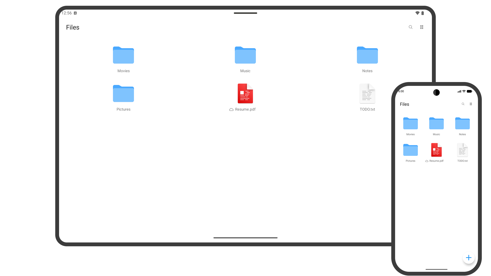

# Amqhi Cloud for Android

[Website](https://amqhi.com/cloud)

Amqhi Cloud manages files, folders, notes, music, and all your data in one place, just like a file manager. Data from other apps appears here as files, and files you add can be used right away in each dedicated app.

## Download

[APK](https://github.com/amqhi/cloud-android/releases/latest)